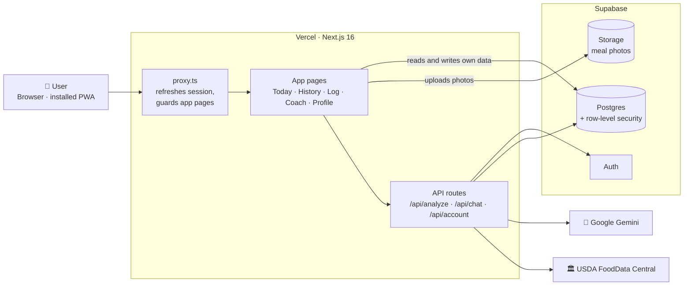
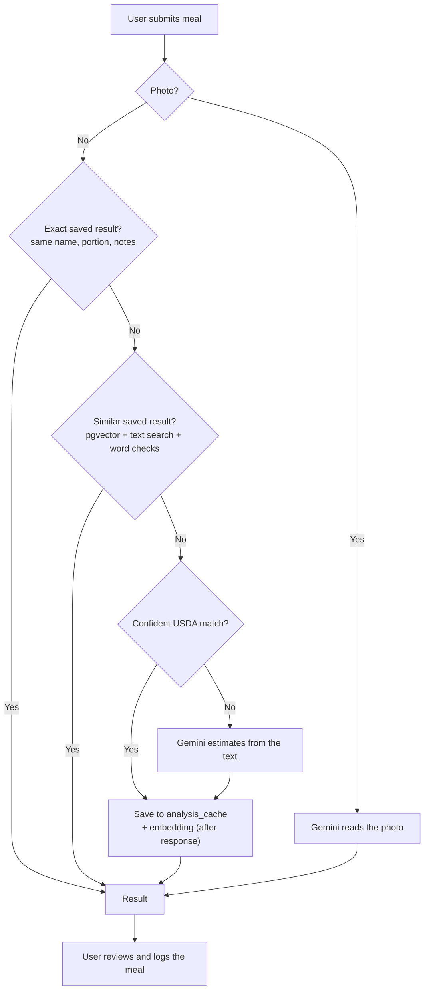
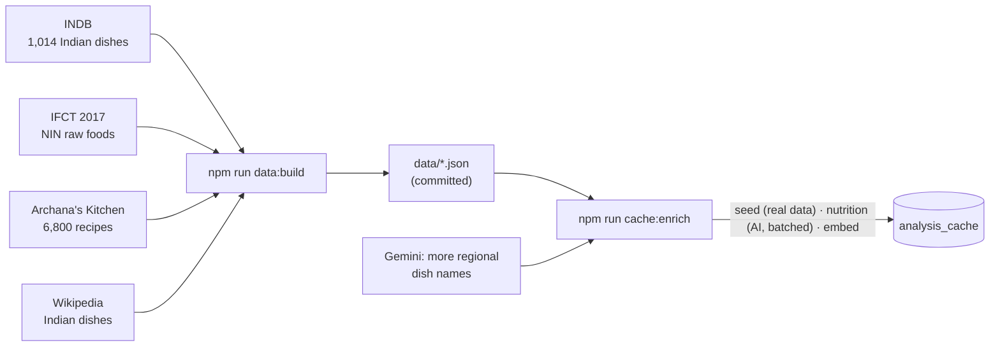
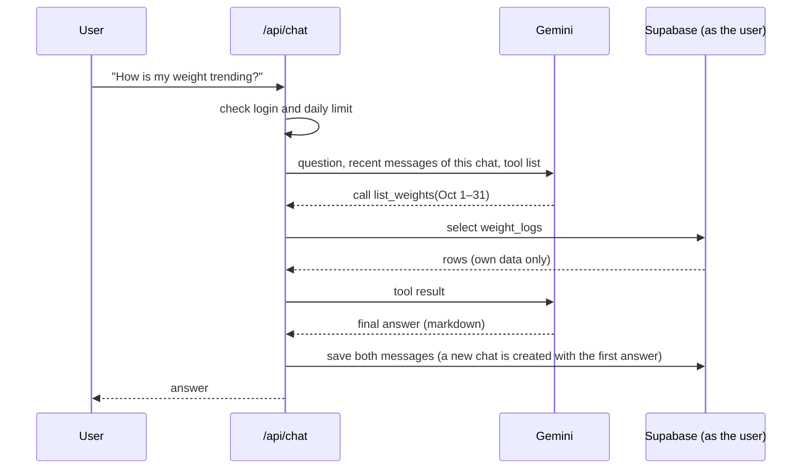
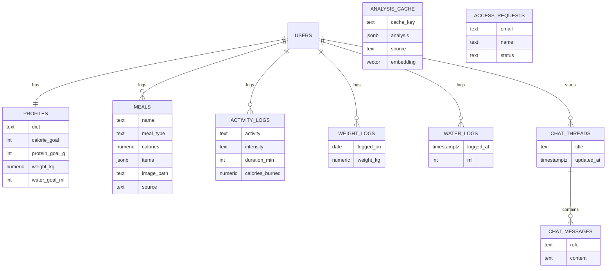

# Architecture

Crazy Rep is one Next.js app on Vercel. It uses Supabase for login, data and photos, Gemini for AI, and USDA for free nutrition data. The same web app runs in the browser and as an installed app (PWA).

## The big picture



**Rule of thumb:** simple reads and writes go straight from the browser to Supabase, where row-level security keeps each user to their own rows. Anything that needs a secret key (Gemini, USDA, account deletion) goes through an API route.

## Logging a meal

The meal name is required; the portion, notes and photo are optional. `analysis_cache` is the **single source of truth**: every answer from USDA or the AI is saved back with an embedding, so the cache keeps growing and AI calls keep shrinking.



**Similar results** use hybrid matching, because similarity alone can't tell chicken biryani from mutton biryani:

1. Vector neighbours (`match_analysis_cache`, cosine, HNSW index) plus rows whose name or aliases contain the typed text.
2. A row is reused only if every typed word is present (small typos allowed), there's no key-ingredient clash (chicken vs mutton), and similarity ≥ 0.70 or the name or alias matches exactly.
3. Close calls between different dishes count as ambiguous and fall through to USDA or the AI.
4. The stored serving is scaled to the user's portion ("2 bowls", "150 g").

### Filling the cache in bulk



### The cache learns from every AI answer

`lookupTextMeal` and the photo path in `/api/analyze` call `seedItemRows` after an AI answer. Each item in the answer (up to 8, only when the AI was at least half sure, skipping zero-calorie and junk names) is saved as its own `analysis_cache` row shaped as a one-food analysis, unless that name and portion is already there. The rows that were really new are embedded in one batch, so one request covers them all. Later, adding that food by name (`/api/analyze/item`) finds it through the usual exact, vector and USDA steps before the AI. The work runs after the response is sent, and a failure never affects the meal being logged (`lib/item-seed.ts`).

### Adding an item that wasn't detected

The results screen and the logged-meal sheet have an "Missing something?" box. `POST /api/analyze/item` splits the text into a name and an amount (`splitItemText`, so "2 rotis" becomes `rotis` and `2`) and calls the same `lookupTextMeal` chain as the meal name box: saved result, then vector search, then USDA, then AI. New answers are saved to `analysis_cache` for the next person. The food items it finds are added to the meal, each with the usual quantity stepper; items added to a logged meal can be removed again before saving.

### Searching what you've eaten

History has a **Meals** tab (`MealSearch.tsx`, `POST /api/search/meals`).

- `meal_dishes()` groups the signed-in person's meals into dishes (same name, ignoring case and spacing) with counts, last and first date, average nutrients, how often each meal type, and the **items found inside those meals** (the detected sub-items, most common first, up to 15). `meal_dish_history()` lists the latest times for one dish, with each meal's items. Both run as the user, so row-level security applies.
- **Sub-items:** each dish is also scored by its items, a little lower than a match on the dish's own name (`ITEM_WEIGHT`), so a dish named for the thing comes first. A card matched through an item says "contains …"; opened, it lists what's in it (tap an item to search for it) and the last meal item by item.
- **By name:** `lib/meal-search.ts` scores each dish name against what was typed using the same word handling as food lookups (`tokens` in `lib/food-text.ts`: spelling variants, plurals, "dahi" = "curd"). Whole words beat a half-typed word.
- **By meaning:** there is one set of vectors, in `analysis_cache`. Every meal points at the cache row for its dish (`meals.cache_key`); the row's vector is made from `embed_text`: the name, what's in it and the notes (e.g. "Masala dosa Contains: coconut chutney. Notes: …"), so a search for an ingredient or "high protein" can find a dish whose name doesn't say so. The app calls `POST /api/meals/index` right after saving a meal; that links it (adding the dish to the cache, shaped from the meal, if it isn't there) and embeds anything that has no vector. Search also links any meals it finds unlinked (100 now, 400 more after the answer is sent). The server embeds the query, and `match_cache_keys()` returns the nearest rows among the keys of *this person's own* meals; a dish is as close as its closest row. Matches must clear `SEMANTIC_FLOOR` and sit within `SEMANTIC_BAND` of the best, and are marked "similar". If the AI is unavailable the search quietly continues by name only. The old `dish_embeddings` table is gone.
- A search runs only when the Search button (or Enter) is pressed, never while typing, because looking for similar dishes costs an embedding call. Repeating the same words within a minute is answered from the app's memory. Tapping a dish or item from a list sends `similar: false`, which skips the AI call (the name is already exact). The embedding quota is shared with food lookups.
- "Log again" opens Log meal with `?name=` and the usual meal type filled in.

## Coach chat

The coach answers questions using read-only tools that run **under the user's own login**, so it can only ever see that user's data.



Tools: `get_profile`, `get_summary`, `list_meals`, `list_activities` and `list_weights`.

The profile's `diet` (vegetarian by default, or eggetarian, non-vegetarian or vegan) is in the coach's instructions, so every food or recipe it suggests fits. The same setting picks the starter dish ideas on the scan screen and drives a gentle heads-up when a logged meal contains something the diet rules out. It also shapes a meal's insights: photo analyses are told the diet, and text analyses (whose results are cached and shared) have their tips fitted to the diet on each response, so one person's diet never reaches another person's tips.

Each user can keep several conversations (`chat_threads`). The coach only sees the messages of the open conversation, the daily message limit counts across all of them, and deleting a conversation deletes its messages.

## Meal reminders

- `reminder_settings` (one row per user: on/off, timezone, a time per meal, `last_sent`) and `push_subscriptions` (one row per device) hold the data. Users can read and change their own settings; subscriptions are written by the server (`/api/push/subscribe`), which only accepts addresses of real push services.
- A `pg_cron` job (`meal-reminders`, once an hour; a second job, `cron-history-cleanup`, deletes run history older than 3 days each day) runs `ping_meal_reminders()`, which uses `pg_net` to POST to `/api/reminders/send` with a shared secret. The app's URL and the secret are stored in Supabase Vault, not in the repo.
- The endpoint checks the secret, then `lib/reminders-run.ts` picks the users who are due in their own timezone (`lib/reminders.ts`), skips meals already logged, sends the push with `web-push`, and removes devices the push service says are gone.
- `public/sw.js` shows the notification and opens `/scan?type=…` when it's tapped.

## Working offline

The installed app can be opened and read without a connection.

- **Opening the app.** For the signed-in pages (`/dashboard`, `/scan`, …) the service worker opens the saved page straight away and refreshes it in the background, so a cold server or a slow sign-in check doesn't hold the launch. If the refresh finds the server redirecting (signed out, access removed), the page is told to go there. A tapped notification is handed to the running app as a message, and the app moves to the page itself without reloading; if no app is running, the saved page opens at once.

- `public/sw.js` keeps the last good copy of each page (network first) and caches `/_next/static` files, so the app shell opens offline. API and Supabase calls are never cached by the service worker.
- `lib/offline.ts` saves the React Query cache to `localStorage` (profile, meals, logs, weights, history summaries, coach chats; not photo URLs, which expire). It is loaded before the first render and saved again as data changes, with a per-kind limit so it stays small.
- Offline, queries with nothing saved wait instead of failing, and each page says so. `useOnline()` disables everything that writes: dashboard date arrows, add and delete buttons, meal edits, the whole profile form, the coach input, and logging a meal. History is limited to the last 7 days, which are fetched whichever range is open. Themes are local, so they still work.
- Signing in, signing out, deleting the account and a flag-forced sign-out clear the saved data and the page cache, so one person's data never shows for the next.

## Data model



- `analysis_cache` isn't tied to a user, and only the server can access it.
- `access_requests` holds emails from the landing page **Request access** form (one row per email). Only the server can read or write it.
- `history_summary()` adds up meals, activity, water and weight per **day, week or month** in the user's timezone. That's how History covers all time quickly: "All" runs from the first day anything was logged (found by `useFirstLogDay`) to today, in day, week or month buckets depending on how long that is.
- A trigger keeps `profiles.weight_kg` in step with the latest weigh-in.
- Schema changes live in `supabase/migrations/` and are applied with `npm run db:push` (or automatically by the GitHub Action).

## Security at a glance

| Layer | What protects it |
| --- | --- |
| Pages | `proxy.ts` sends signed-out users to `/login` |
| Data | Row-level security on every user table |
| Photos | Private bucket; one folder per user |
| Secrets | Gemini, USDA and Supabase secret keys stay on the server |
| Input | Zod on every form, API body and AI response |
| AI quota | Model fallback, a daily chat limit and saved results |
| Admin tools | The **API test** tab (`/api-test`) is visible only to admins (`admin-users` flag); its API returns 403 for everyone else |
| Feature flags | LaunchDarkly `sign-in-users` (who can use the app, checked in `proxy.ts` on every request) and `admin-users` (who sees and can call admin tools). Users are sent as a `user` context keyed by user ID; email is private and used in targeting rules. |

## Where things live

```
app/
  (tracker)/       signed-in app: dashboard, scan, history, coach, profile
  api/             analyze, chat, account, admin/food-test
  login/ …         auth screens, privacy, landing page
components/ui/     shadcn/ui components
lib/
  schemas.ts       all Zod schemas
  meal-lookup.ts   exact → similar (vector) → USDA → Gemini
  vector-lookup.ts hybrid pgvector + text matching
  embeddings.ts    Gemini embeddings (768 dims)
  usda.ts          USDA matching and portions
  gemini.ts        prompts and model fallback
  coach.ts         coach tools and chat loop
  flags.ts         LaunchDarkly flag keys, defaults and user context (flags-server.ts for API routes)
  supabase/        browser, server and proxy clients
supabase/migrations/   database schema history
scripts/               data builders and the cache enrich script
data/                  dish catalogue and Indian food data (inputs for enrich)
```

## Tech stack

Next.js 16 · React 19 · Tailwind CSS v4 · shadcn/ui · Zod · react-hook-form · Supabase · Google Gemini · USDA FoodData Central · LaunchDarkly · Vercel
