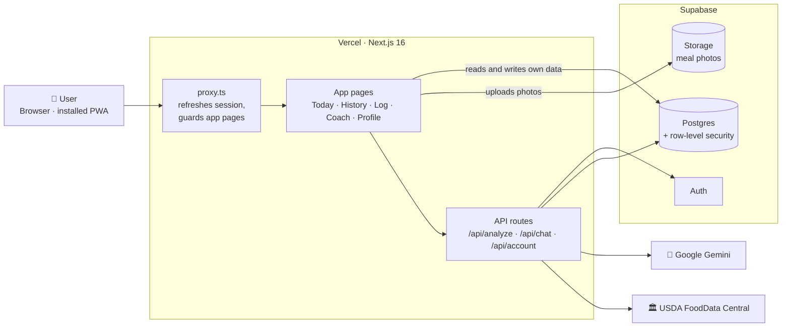
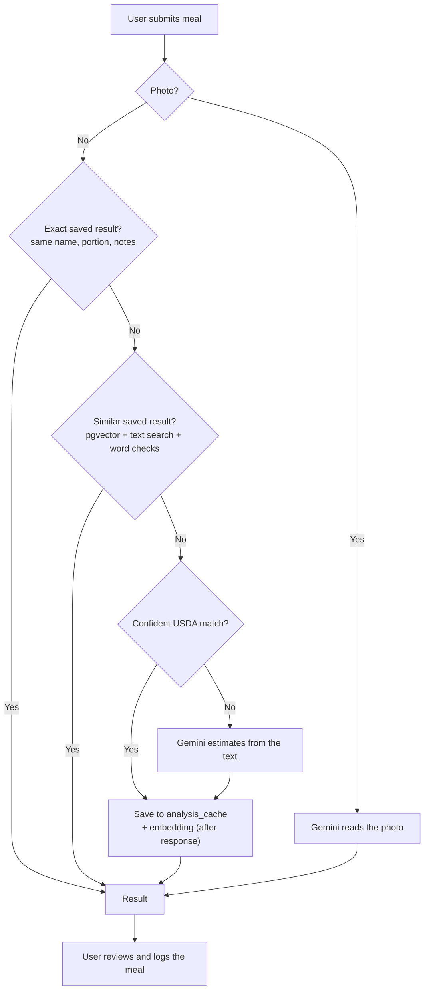
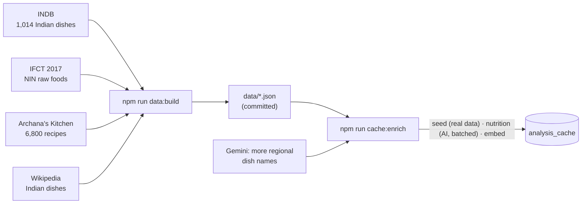
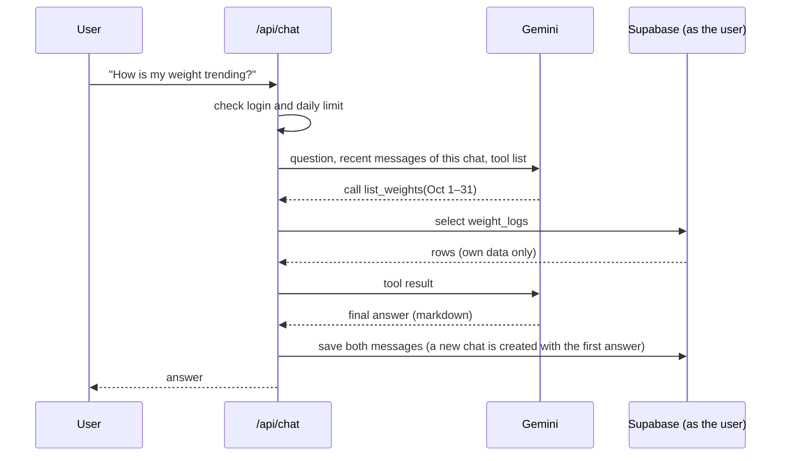
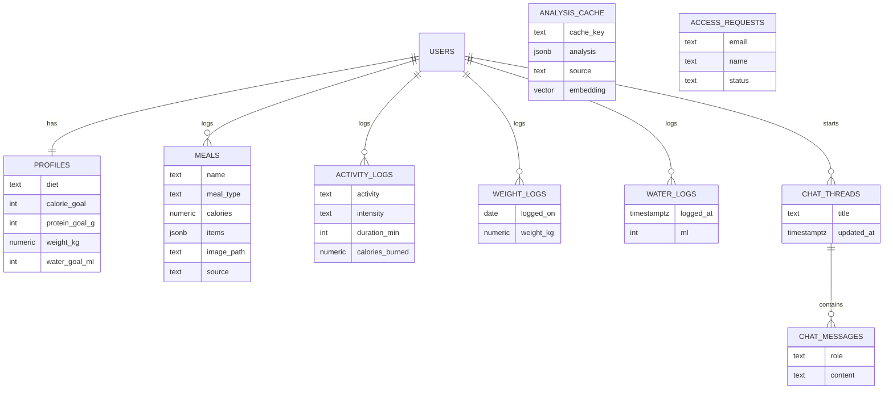

# Architecture

Crazy Rep is one Next.js app on Vercel. It uses Supabase for login, data and photos, Gemini for AI, and USDA for free nutrition data. The same web app runs in the browser and as an installed app (PWA).

## The big picture



**Rule of thumb:** simple reads and writes go straight from the browser to Supabase, where row-level security keeps each user to their own rows. Anything that needs a secret key (Gemini, USDA, account deletion) goes through an API route.

## Logging a meal

The meal name is required; the portion, notes and photo are optional. `analysis_cache` is the **single source of truth**: every answer from USDA or the AI is saved back with an embedding, so the cache keeps growing and AI calls keep shrinking.



**Similar results** use hybrid matching, because similarity alone can't tell chicken biryani from mutton biryani:

1. Vector neighbours (`match_analysis_cache`, cosine, HNSW index) plus rows whose name or aliases contain the typed text.
2. A row is reused only if every typed word is present (small typos allowed), there's no key-ingredient clash (chicken vs mutton), and similarity ≥ 0.70 or the name or alias matches exactly.
3. Close calls between different dishes count as ambiguous and fall through to USDA or the AI.
4. The stored serving is scaled to the user's portion ("2 bowls", "150 g").

### Filling the cache in bulk



## Coach chat

The coach answers questions using read-only tools that run **under the user's own login**, so it can only ever see that user's data.



Tools: `get_profile`, `get_summary`, `list_meals`, `list_activities` and `list_weights`.

The profile's `diet` (vegetarian by default, or eggetarian, non-vegetarian or vegan) is in the coach's instructions, so every food or recipe it suggests fits. The same setting picks the starter dish ideas on the scan screen and drives a gentle heads-up when a logged meal contains something the diet rules out. It also shapes a meal's insights: photo analyses are told the diet, and text analyses (whose results are cached and shared) have their tips fitted to the diet on each response, so one person's diet never reaches another person's tips.

Each user can keep several conversations (`chat_threads`). The coach only sees the messages of the open conversation, the daily message limit counts across all of them, and deleting a conversation deletes its messages.

## Data model



- `analysis_cache` isn't tied to a user, and only the server can access it.
- `access_requests` holds emails from the landing page **Request access** form (one row per email). Only the server can read or write it.
- `history_summary()` adds up meals, activity, water and weight per **day, week or month** in the user's timezone. That's how History covers 5 years quickly.
- A trigger keeps `profiles.weight_kg` in step with the latest weigh-in.
- Schema changes live in `supabase/migrations/` and are applied with `npm run db:push` (or automatically by the GitHub Action).

## Security at a glance

| Layer | What protects it |
| --- | --- |
| Pages | `proxy.ts` sends signed-out users to `/login` |
| Data | Row-level security on every user table |
| Photos | Private bucket; one folder per user |
| Secrets | Gemini, USDA and Supabase secret keys stay on the server |
| Input | Zod on every form, API body and AI response |
| AI quota | Model fallback, a daily chat limit and saved results |
| Admin tools | The **API test** tab (`/api-test`) is visible only to admins (`admin-users` flag); its API returns 403 for everyone else |
| Feature flags | LaunchDarkly `sign-in-users` (who can use the app, checked in `proxy.ts` on every request) and `admin-users` (who sees and can call admin tools). Users are sent as a `user` context keyed by user ID; email is private and used in targeting rules. |

## Where things live

```
app/
  (tracker)/       signed-in app: dashboard, scan, history, coach, profile
  api/             analyze, chat, account, admin/food-test
  login/ …         auth screens, privacy, landing page
components/ui/     shadcn/ui components
lib/
  schemas.ts       all Zod schemas
  meal-lookup.ts   exact → similar (vector) → USDA → Gemini
  vector-lookup.ts hybrid pgvector + text matching
  embeddings.ts    Gemini embeddings (768 dims)
  usda.ts          USDA matching and portions
  gemini.ts        prompts and model fallback
  coach.ts         coach tools and chat loop
  flags.ts         LaunchDarkly flag keys, defaults and user context (flags-server.ts for API routes)
  supabase/        browser, server and proxy clients
supabase/migrations/   database schema history
scripts/               data builders and the cache enrich script
data/                  dish catalogue and Indian food data (inputs for enrich)
```

## Tech stack

Next.js 16 · React 19 · Tailwind CSS v4 · shadcn/ui · Zod · react-hook-form · Supabase · Google Gemini · USDA FoodData Central · LaunchDarkly · Vercel
